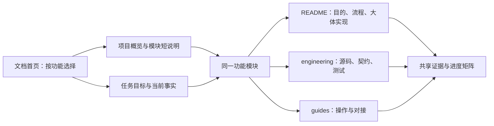
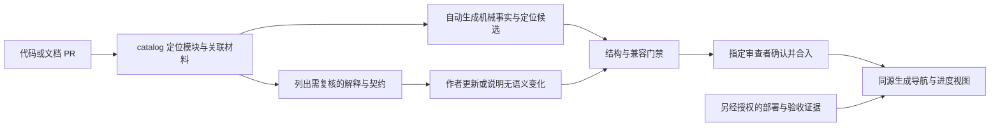

# YINYU 文档体系审计与维护方案

日期：2026-10-11。初始源码基线：`origin/main 03440c51`；提交前已正常合入最新主线 `b1812d15`。第一轮清理为 `28a350e4`，整个文档任务仍未合入 main。本方案审计两者，归档仅列文件，不通读正文。目标目录与自动维护机制为推荐设计，已执行的修正和检查另行列明。

## 先读这一页

推荐采用 **功能模块作为主目录，阅读深度作为模块内分层，机器可验证的事实单独维护** 的结构。项目介绍、模块解释、工程定位、操作手册和历史证据各有固定位置；人类与 AI 使用不同阅读路径，共用同一份事实。

原设计在架构治理、禁止旧方案误导、保留运行证据方面合理。它按材料类型和建设阶段组织，对熟悉项目的维护者方便；随着模块增加，缺少产品视角、短模块入口、完整代码映射和变更触发，逐渐成为“知道文档名才能找到文档”的结构。

你的六项顾虑总体成立。需要补充：长参考文档可以保留，但不应成为起点；人类开发者也需要工程文档；代码或测试变化只能自动发现文档可能过期，不能自动证明功能已完成或生产已验收。

第一轮已经减少重复状态和旧计划；它仍主要按文档类型分组，120 行上限与链接检查也不足以保证易读和语义正确。第二轮建议优先补“项目图 + 模块短说明 + 真实代码地图”，随后引入变更感知维护，最后按模块迁移旧材料。避免先大规模改目录，再等待有人补正文。

- 新人：项目概览 → 能力矩阵 → 目标模块短说明，约 5–10 分钟，跳过契约与历史记录。
- 开发者 / AI：AGENTS → 任务相关当前事实 → 模块工程页 → 必要契约、源码与定向测试。
- 运维 / 对接人员：目标模块操作入口 → 前提、操作、核验与回退；不从研发流水里猜步骤。

本文件是治理方案审查材料，日常任务无需必读；实施完成后稳定规则进入 AGENTS/导航，审计记录封存。模块短说明、代码地图与维护门禁是验收目标，不以删掉多少文件为完成标准。

按需阅读：[六项判断](#2-对六项顾虑的评估) · [目标结构](#3-推荐目标结构) · [自动维护](#5-自动化方案与边界) · [迁移与验收](#6-落地顺序与验收)。

## 1. 当前设计的目的、合理性与失效点

以下目的依据已有文件声明与结构判断，不推测作者个人意图。现行模块化单体、独立 Agent、统一部署队列、独立 worktree、审查和部署授权规则继续保留。

| 原设计 | 合理目的 | 暴露的问题 |
| --- | --- | --- |
| AGENTS + current-state + 文档导航 | 分开稳定规则、变化事实和入口，降低 AI 接手成本 | 多个总交接重复事实；新人被要求先读技术规则；状态不断追加旧部署 |
| commercialization/ | 集中商业化阶段的术语、边界、API 和专项能力 | 成为容纳架构、用户指南、市场研究、参考和运维的混合目录，名称难提示具体功能 |
| development/ + handoffs/ | 支持长任务、多人接力和跨会话恢复 | 计划、当前事实、手册和封存记录混放；一任务多份阶段记录；历史过程在现行搜索中占多数 |
| operations/ 与 runbooks/ | 将危险操作与开发实现分开，保留前提、验收、回退 | 运维材料仍分散在多个目录；使用、接口和底层操作混在长手册中 |
| modules/README | 将代码模块关联到现行材料，显式登记覆盖缺口 | 只有覆盖矩阵，缺各模块完整而简短的入口；很多条目回指总纲和页面/API 大表 |
| archive/ + 事实优先级 | 保留历史证据，防止旧计划推翻现网 | 归档降低权威但未自动降低搜索噪声；“老”与“过期”仍容易混为一谈 |
| 文档随代码更新、提交前检查 | 尽量让实现、测试和说明闭环 | 缺少明确责任与变更感知；靠提醒，无法发现“只改代码”的 PR 所遗漏的文档 |

初始主线有 131 份非归档 Markdown、160 份归档；第一轮 28a350e4 后非归档为 120 份、归档 165 份。以下盘点固定于该统计点：120 份中 64 份 handoff、6 份测试资料，剩余 **50 份说明、规则和入口**。按目录看：development 75、commercialization 22、根目录 10、operations 8、modules 3、节点/Registry 各 1。其中 59 个文件名含 TeamLab，表明资料覆盖明显集中，不能把整个项目的文档覆盖等同于 TeamLab 覆盖。

50 份中有 8 份至少 400 行、3 份至少 800 行。TeamLab 操作/API 手册 2673 行、对接指南 866 行；modules/ 实际只有索引、培训容器生命周期、TeamLab 运行事实契约。源码有 12 个 Modules 目录，Agent 另在独立项目。以上是文件/行数盘点，不能据此断言长文全部冗余或内容全部过期。提交前同步 PR #26 后新增一个任务记录和练习分页说明，当前分支非归档为122份（51份说明/入口、65份handoff、6份测试资料），modules为4份；新增内容有明确价值，但统一短入口仍未补齐。

还发现了一个语义冲突：[TeamLab 手册](../operations/teamlab-networking-operations-manual.md)原先将 ApiOperation 状态写作 queued/running/completed/failed/cancelled；当前 [枚举](../../src/GZCTF/Modules/Audit/Domain/ApiOperation.cs)与 [OpenAPI](../commercialization/openapi/open-v1.json)实际只有 Pending/Running/Succeeded/Failed，对应 0–3。本轮已修正该段。这种错误能通过文件链接检查，说明检查“文件存在”和“描述符合代码”是两件事。

另外，[Provisioning 实现](../../src/GZCTF/Modules/Provisioning/Application/AcademicImportApplicationService.cs)实际处理课程、理论题/试卷、战队的批量导入，不能因模块名称就称它为 VM/容器部署编排。培训关键入口还位于 Controllers/Repositories/Services，自动把 `Modules/Training` 全部内容当作完整培训实现会漏掉主链路。

## 2. 对六项顾虑的评估

| 顾虑 | 审计判断 | 方案中的对应措施 |
| --- | --- | --- |
| 1. 多且长，无从读起 | 成立。主要阅读入口缺少长度与层次约束；历史证据数多本身不是缺陷 | 限定首读范围；短概览与可检索参考分开；默认搜索排除历史 |
| 2. 缺模块化分组 | 部分成立。已有类型目录和模块矩阵，但缺产品功能到资料的直接路径 | 按功能设模块目录，跨模块技术设 architecture，任务独立索引 |
| 3. 功能与技术细节混杂 | 成立。手册常从功能介绍直接进入 API/执行字段，没有“实现概览”这一层 | 模块 README 解释业务流程与大体实现；engineering 给源码/测试定位；reference 留细节 |
| 4. 人类与 AI 面向不明 | 成立，但读者与深度不完全等价。人类工程师、运维和对接人员也需要技术细节 | 同一模块提供概览与工程视图，按角色导航；不复制两套功能和状态 |
| 5. 维护性差、容易漂移 | 成立，原因不在 Markdown 格式。没有关联代码、责任和审核证据，改代码就无法触发复核 | 文档目录清单记录主题/责任/来源；代码变更自动产生相关文档复核任务 |
| 6. 缺自动整理与更新 | 成立，现有生成客户端/OpenAPI/质量检查是局部自动化，并非文档完全无自动化 | 自动生成机械事实、检查结构与漂移、提示复核；语义修改走审查，验收状态依据证据更新 |

## 3. 推荐目标结构

目录以用户要找的功能为主，以用途和深度为次。产品功能不要求与 C# 目录一一对应；一张映射表连接两者。跨模块契约只维护一处，其他模块链接过去。

```text
AGENTS.md                           # 稳定工程与协作规则
README.md                           # 简短项目介绍、本地启动、进入 docs

docs/
  README.md                         # 人员/任务双入口 + 功能目录，约一屏
  overview/
    project.md                      # 解决什么问题、谁使用、平台图
    architecture.md                 # 主站/数据/Agent/入口关系，大体实现
  modules/
    README.md                       # 自动生成模块导航
    ctf/                            # CTF 与相关渗透玩法，映射 Ctf/Penetration
    awdp/  theory/  training/  exercise/  teamlab/  identity/
    content/  runtime/  audit/  provisioning/  # 共享底座与批量导入
      README.md                     # 该模块短说明，所有读者都能先读
      engineering.md                # 代码地图、关键链路、不变量、测试入口
      guides/                       # 按需要：用户操作、对接、模块运维
      reference/                    # 按需要：状态机、网络、字段等深度说明
  architecture/                     # 模块边界、API标准、缓存/数据/前端共用规则
  operations/                       # 全站发布/回滚、节点、Registry、数据库运维
  reference/                        # 生成 API/配置参考，按模块可筛选
  status/
    facts.json                      # 能力实现/软件验证/部署/现场验收的证据索引
    progress.md                     # 从同一事实生成的能力与进度矩阵
    backlog.md                      # 仍未闭环事项，按模块与负责人归属
  tasks/
    active/                         # 跨会话进行中任务；一任务一主记录
    records/                        # 封存的提交/部署/测试证据，按需检索
  catalog.json                      # 文档/模块/代码来源/责任/阅读层次的机器清单
  archive/                          # 已替代设计和唯一历史材料，默认不进入阅读导航
```

这是目标结构，**不为每个模块预建空的 guides/reference 文件，也不要求每项功能新写一套手册**。模块最低两页；简单模块工程说明短，复杂模块再拆专题。当前 current-state/handoffs 路径在迁移前继续有效，不能在只更新树形图的提交里把读取入口切到尚不存在的位置。

运行底座模块覆盖 Runtime、Services/Fleet、VM 相关代码和 Agent；节点、Docker、KVM、镜像相关说明按职责链接，不机械复制到每个业务模块。Provisioning 的产品名称为“批量导入”，讲清其对 Training/Theory/Identity 的调用。CTF 中的渗透玩法映射 Penetration，保留独立业务边界。

### 3.1 功能目录怎样帮助理解项目

项目概览至少应提供以下模块解释；这里给出当前源码与总纲支持的大体关系，用于说明推荐的阅读层次，不扩大宣称生产验收。

| 功能入口 | 读者先理解什么 | 大体实现方式 |
| --- | --- | --- |
| CTF / 渗透玩法 | 比赛、参赛队伍、题目、提交与计分 | Ctf 保存赛事事实，内容提供题目/附件/Flag，运行底座执行实例；Penetration 绑定 TeamLab 与比赛目标、提交和得分 |
| AWDP | 按轮次运行服务、检查、攻击与修补 | Awdp 维护服务/轮次/Checker/计分，资源执行复用运行底座，真实攻防另验收 |
| 理论考试 | 题库、试卷、答题与成绩 | Theory 维护题目、答卷快照、提交与判分；不把课程学习进度当答卷事实 |
| 培训课程 | 教师组织课程，学员按章节学习与实验 | Training 管课程/授权/进度，实验绑定课程拥有的 Exercise 题目，容器通过统一队列执行 |
| 自主练习 | 随时练题、创建独立实例、提交与统计 | Exercise 保存公共练习定义和用户实例，与比赛及课程实例事实隔离 |
| TeamLab | 将多台资产和网段设计成可重复运行的场景 | 草稿发布为不可变版本，计划调度为 runtime，由 Agent 执行网络/容器/VM，主站保存状态与访问权限 |
| 身份与权限 | 登录、账号、角色、外部调用授权 | Identity 管理本地/SSO身份与 API token/grant，业务对象授权由对应应用边界校验 |
| 内容与镜像 | 可复用题目资产、附件和模板 | Content 管目录与引用，可靠来源存储制品，Worker 缓存支持实际部署；缓存不是唯一主副本 |
| 运行、节点与 Agent | 不同功能怎样共用容器和 VM 执行 | Runtime/队列/容量服务安排工作，Agent 仅执行本机资源操作，PostgreSQL保存事实，Redis用于缓存/协调 |
| 审计与异步操作 | 操作如何找回、失败如何追溯 | Audit 提供日志/operation/审计，业务运行状态仍从其所属事实源读取 |
| 批量导入 | 外部系统怎样批量创建教学/人员资料 | Provisioning 保存导入任务与幂等提交，经已有业务服务导入课程、理论资料与战队 |

模块首页解释到这一层；字段、命令、接口示例和容器/网卡参数进入工程页或专题参考。产品图显示这些关系，完整允许依赖矩阵仍只有一个架构契约。

### 3.2 阅读层次与内容预算

| 层次 | 回答的问题 | 内容与预算 |
| --- | --- | --- |
| 项目概览 | 项目能做什么、由什么组成 | 产品图、功能目录、约 800–1500 中文字；不放原始 API/日志 |
| 模块短说明 | 谁使用、做什么、大体怎样实现、边界在哪里 | 5–7 个小段，约 500–1000 中文字、一张流程图；状态链接到同源矩阵 |
| 工程定位 | 修改该功能应从哪里读、会影响什么 | 首段和定位表约 1000–1500 中文字；详细契约链接出去，优先目录/类名而非易漂移行号 |
| 操作指南 | 完成一件实际工作如何操作 | 前提→步骤→结果核验→失败/回退；接口例子只覆盖该任务 |
| 深度参考 | 某个字段、状态或网络机制是什么 | 不硬限全文长度；有目录、明确归属与证据来源，能按主题查找 |
| 状态与任务 | 做到哪、哪些未验收、下一步是什么 | 能力矩阵与活动任务摘要；完整运行流水和历史测试数字不进入日常首页 |

字符预算是设计目标，初期超过时提醒；不把字符上限变成删掉关键安全前提的理由。原 120 行限制保留作过渡门禁，但一行超长表格也可能难读，后续应同时检查字数、首屏密度与入口深度。



### 3.3 培训模块的具体写法

短说明示例：培训让教师组织课程、章节、资料、实验和课后理论，学员报名后按章节学习，系统记录提交与学习进度。大体链路为“课程授权→课程拥有的实验题→学员独立实例→统一部署队列→节点容器→提交/进度”，课程不是另一套容器调度系统。

说明只解释关键边界：课程与公共练习的实例额度隔离；课程默认每用户 3 个运行或排队实例，达到额度拒绝新建而不驱逐其他课程实验；动态 Flag 按实例隔离。动态额度已在新主线增加管理员设置入口，保存后影响下一次准入，不销毁既有实例。实例隔离的软件验证与已知生产部署引用 10-11 证据，不能由这段介绍推断培训 VM、全部业务流程或所有故障已验收。

工程页对应的代码地图应是下表，读者能直接定位；这不是对整个培训模块已全面审计的声明。

| 要解决的问题 | 当前主线起点 |
| --- | --- |
| 学员读取、报名、实验操作与授权 | [TrainingCourseController](../../src/GZCTF/Controllers/TrainingCourseController.cs)、[后台入口](../../src/GZCTF/Controllers/TrainingCourseAdminController.cs) |
| 页面和 feature API adapter | [training features](../../src/GZCTF/ClientApp/src/vnext/features/training)、[实验 adapter](../../src/GZCTF/ClientApp/src/vnext/features/training/chapter/trainingChapterApi.ts) |
| 实例额度、幂等、Flag 初始化 | [ExerciseInstanceRepository](../../src/GZCTF/Repositories/ExerciseInstanceRepository.cs)、[TrainingContainerPolicy](../../src/GZCTF/Models/Internal/TrainingContainerPolicy.cs) |
| 课程删除与内容引用 | [TrainingCourseDeletionService](../../src/GZCTF/Modules/Training/Application/TrainingCourseDeletionService.cs)、[模块实现](../../src/GZCTF/Modules/Training) |
| 动态额度管理 | [AdminController](../../src/GZCTF/Controllers/AdminController.cs)、[设置面板](../../src/GZCTF/ClientApp/src/vnext/features/admin/system/TrainingContainerQuotaPanel.tsx)；已进入新主线，部署与实测另核 |
| 容器执行票据 | [DeploymentQueueService](../../src/GZCTF/Services/Fleet/DeploymentQueueService.cs)，共享 Runtime/Agent 链路 |
| 定向验证 | [生命周期单测](../../src/GZCTF.Test/UnitTests/Training/TrainingContainerLifecycleTests.cs)、[API/PG 并发额度](../../src/GZCTF.Integration.Test/Tests/Api/TrainingContainerQuotaTests.cs)、[真实 Docker](../../src/GZCTF.Integration.Test/Tests/Repository/TrainingContainerDockerTests.cs) |
| 稳定规则与发布证据 | [课程生命周期](../modules/training-container-lifecycle.md)、[10-11 发布](handoffs/2026-10-11-training-runtime-mainline.md) |

同样的结构用于每个模块。自动扫描模块目录可生成候选路径，但这些跨目录共享入口必须经过责任人确认；接口字段继续从 OpenAPI 获取，不在工程页再复制整份 DTO。

## 4. 事实、状态与维护责任

采用一份机器清单和一份证据索引，避免人类概览、AI定位页、状态页分别维护“已完成”。catalog 负责发现与归属，facts 负责可追溯状态，解释文字由模块作者维护。

| 数据 | 最小内容 | 更新责任 |
| --- | --- | --- |
| 文档清单 catalog | 文档 ID、主题/模块、用途/读者、状态（草稿/现行/证据/历史）、路径、维护角色、关联源码范围 | 模块维护者审核归属；文档治理者维护 schema/索引 |
| 源码复核依据 | 复核时的源码范围内容摘要、复核提交、关键入口/测试；范围必须包含共享文件 | 作者维护 watch 范围，CI 比较变化；不在每次自动运行时重写复核日期 |
| 能力证据 facts | 功能 ID、实现提交/PR、软件验证的提交/范围、部署的组件身份/环境、实机验收的时间/范围、限制、证据链接 | 集成者登记合入；CI登记软件检查；发布/验收者登记实际环境 |
| 后续事项 | 模块、问题/风险、责任角色、下一步、验收/关闭证据 | 当前任务负责人；未分配必须明确，不能假设某 AI 会继续 |

catalog 不记录完整类/字段/文件清单；生成扫描结果可作为工程页附属索引。facts 保留当前有效证据引用，不复制日志、Cookie、完整连接串或大量测试流水。工程定位是代码地图而非第二份源码。

能力矩阵显示四个独立维度：**已合入代码 / 软件验证 / 已部署 / 目标环境实测**，每格能点到证据。不用单一“完成率”或绿色勾选覆盖全部环境；没有证据时显示未记录或未验收。源代码存在、CI 通过、服务健康、实机用户链路通过分别解释，不互相替代。

人类的 progress 矩阵、AI 接手摘要从同一 facts 生成；模块 README 不复制生产 SHA、测试数量或百分比。AGENTS 保存稳定要求；PR/任务记录承载讨论和过程；发布清单/现场回读承载环境身份。机器文件和生成页面在同一提交变化，生成页面禁止手改。


可审查的 catalog 条目示意（拟定格式，未创建该机器文件；责任角色尚待分配给实际维护者）：

```json
{
  "id": "training.engineering",
  "module": "training",
  "kind": "engineering",
  "audiences": ["developer", "ai"],
  "ownerRole": "training-maintainer",
  "document": "docs/modules/training/engineering.md",
  "watchPaths": [
    "src/GZCTF/Modules/Training/**",
    "src/GZCTF/Controllers/TrainingCourse*.cs",
    "src/GZCTF/Controllers/AdminController.cs",
    "src/GZCTF/Repositories/ExerciseInstanceRepository.cs",
    "src/GZCTF/Models/Internal/TrainingContainerPolicy.cs",
    "src/GZCTF/ClientApp/src/vnext/features/training/**",
    "src/GZCTF/ClientApp/src/vnext/features/admin/system/TrainingContainerQuotaPanel.tsx",
    "src/GZCTF/ClientApp/src/vnext/features/admin/system/useTrainingContainerQuota.ts"
  ],
  "reviewedCommit": "<实际复核的代码提交>",
  "reviewedScopeHash": "<关联路径与内容的稳定摘要>"
}
```

该范围只是培训样例的起点，采用前还需加入实际共享队列/授权/测试依赖；watchPaths 由维护者校准，不能把示例当成完整覆盖证明。catalog 每条唯一 documentId，facts 每项唯一 capabilityId，生成器只引用对应 ID，防止两份数据维护相同状态。

## 5. 自动化方案与边界

推荐先用仓库内 Python/JSON/Markdown 与现有 GitHub Actions，免维护新知识库服务。导航增长到确有需要时再提供静态站点搜索；站点从同一 Markdown 构建，不复制一份正文到外部 Wiki。

| 机制 | 自动完成什么 | 需要谁判断 |
| --- | --- | --- |
| 结构与链接校验 | 文件/入口/锚点存在、catalog 完整、所有模块有有效入口、生成结果与数据一致；每个 PR 都运行，包含只改代码的 PR | 审查者判断模块归属是否合理，不由目录名推断 |
| 代码变更影响 | diff 匹配 watch 范围；列出受影响文档、漏入 catalog 的新增模块/路径、过期源码链接或被删除符号 | 作者选择“更新”或“行为未变化无需改正文”，后者须有具体原因和复核提交 |
| API/配置/迁移参考生成 | 从已有 OpenAPI、验证过的配置模型和可发现迁移提取字段/清单；有序稳定生成、禁止敏感默认值 | 标准/状态机/业务不变量由维护者写；模型清单不等于生产已执行迁移 |
| 文档复核门禁 | 代码影响了文档来源却无复核结论时阻断；确认新功能有模块入口；敏感记录扫描与未分配责任提示 | 同一文档改了几个字不足以通过语义审查，不以“出现文档 diff”替代复核 |
| 测试与发布证据接线 | 引用 CI run、实际提交/组件/验收产物，生成状态矩阵；没有目标环境证据不自动填“已验收” | 发布与验收者确认范围、身份、失败和限制；只做允许范围内的操作 |
| 定期漂移报告 | 例如每周对当前主线生成可定向复核的清单：未分类、来源变更、缺模块入口、悬空链接；无变化则静默 | 模块责任人处理；年龄只作复核提醒，不自动认定过期或删除 |
| AI 整理建议 | 基于具体 diff 和源码为受影响页生成修改建议/PR 草稿，包含证据与测试 | 独立审查后合入；不自动批量重写业务解释、认证规则、验收状态或删历史证据 |

变更判定先到模块，再到文档：识别新增模块/关键共享文件，无法归属就提示补清单，不能因 watch 不匹配而静默跳过。公开 API、权限、配置和状态语义变更要求工程/契约复核；纯内部重构允许声明正文不变，但源码定位变化仍更新代码地图。PR 结构化复核记录放在提交中，关联实际 diff；任务记录引用它，避免第三套日志。

复核指纹计算关联范围的路径与内容（包括新增、删除），排除生成制品和无关构建输出，采用稳定排序。因同一共享仓储触发多个模块时，允许一条复核结论明确覆盖多个模块；不得每改一个文件就强迫逐页改字。无法覆盖动态运行语义的部分保留人工审查，CI 检查具备承接证据而非宣称语义已经被证明。



本分支已有的链接/120 行检查仅是第一步。它不检查锚点、源码语义、catalog 或代码变更影响；第一轮 Documentation workflow 的 paths filter 不覆盖普通只改代码的 PR，本轮已移除过滤，在本分支补齐所有 PR/主线提交的检查触发；这样删除文档已链接的源码也能触发文件检查。精确的代码影响识别仍属于目标实现，应在 job 内识别影响范围，而不是靠 workflow 跳过。“是否必需检查”还需在仓库 branch protection 中落实，本次没有修改远端规则或启动定时任务。

## 6. 落地顺序与验收

| 阶段 | 具体交付 | 验收条件 |
| --- | --- | --- |
| A：先形成可读入口 | 项目概览/关系图、功能目录、各功能模块短说明；Training/TeamLab 先做工程样板 | 新读者不用读手册，5–10 分钟能说明主要功能及关系；其他模块逐个补齐，有缺口明确显示，不堆空模板 |
| B：建立单份清单与机械校验 | catalog 与 JSON schema、当前事实证据索引、同源生成导航/矩阵；补代码路径检查 | 全部实际源码模块及 Agent/跨目录入口有归属；生成结果可复现；删除来源/新增模块会提示 |
| C：接入变更感知维护 | 所有 PR 的影响与复核门禁、模板中结构化文档影响、CI/发布证据接线 | 故意只改受监测代码而不复核，门禁失败；纯重构有充分声明可通过；无实机证据不能升级现场状态 |
| D：按模块迁移与提炼 | 将现有功能、工程、操作、参考分别归位；一次只迁一个模块，修当前引用；删除重复来源 | 原使用/API信息与回退证据有明确承接；全量链接与相关业务契约门禁通过；AGENTS 等入口在同提交切换 |
| E：持续复核 | 定期只读漂移报告；复杂/高风险模块复核；可选同源静态站点搜索 | 无问题不反复通知；发现问题有责任角色和处置；正文变更/删除走 PR，不自动部署 |

以 A→B→C→D→E 推进，不先更换文档平台或全仓机械搬目录。D 中若迁移 OpenAPI 快照/生成来源，必须同时更新生成脚本、CI、测试和消费者；首阶段保留原路径。正在进行任务保持一个主记录，完成后转 records；过期设计只有在未决要求提取、当前使用者无依赖且证据被承接后才删除或归档。

验收用具体查找任务：找课程实例额度实现和回归；找 TeamLab 操作状态定义；找某能力哪些环境没有验收；找节点发布与回退步骤。目标是从 docs 首页 **两次选择到模块入口，再一次选择到所需工程/操作材料**。这需要新人试读；本次提供真实培训样例，但没有伪写成已完成用户可用性试验。

衡量四项：模块入口覆盖、首读字符预算/查找深度、代码变更无复核的漏检、状态证据可追溯。文件总数与过期提醒数量是辅助数据；不追求固定文档总数、不把所有历史记录永久塞进现行检索。

## 7. 本次交付与后续边界

第一轮清理仍在本任务分支，未进入 main；本轮交付的是上述审计与推荐方案，并修正抽样发现的 ApiOperation 状态说明与 Provisioning 归属描述，补齐文档门禁对只改代码 PR 的触发。没有批量迁移所有模块，没有实现 catalog/语义门禁/定时机器人，没有新增生产操作。方案示例与未实施机制分别标明。

现行入口仍是 [文档导航](../README.md)；第一轮状态摘要见 [current-state](current-state.md)，生产证据仍保留原任务记录。同步时 PR #26 的实现已在 main，但其交接仍记录实施/验证阶段；本轮依据 Git 登记“已合入”，没有据此补写“已部署/已验收”。它再次说明状态必须关联事件与证据，不能只靠编辑人记得回写。

本方案的实施缺口归 [backlog](backlog.md) 的 DOC-01/DOC-02；六项问题的整体落实应另按阶段验收，不能由第一轮 9 份删除或一次链接检查宣布闭环。

本轮 Git、验证与交接见 [任务记录](handoffs/2026-10-11-docs-collaboration-audit.md)。当前读者可先看前述“一页结论”和结构图，工程审查者再看自动化/迁移细节，第一轮清理清单仅供追溯。

<details>
<summary>附录：第一轮已经执行的清理清单与原文追溯</summary>

## 清理清单

以下九份从现行树删除，Git 历史保留原文；没有删除业务源码、迁移、生成 API、运维脚本或发布证据。

| 删除的 docs/development 文件 | 理由与承接位置 |
| --- | --- |
| `current-handoff.md` | 与 AGENTS/current-state/导航重复，含已过时部署基线；当前事实与历史稳定基线记录承接 |
| `ai-development-playbook.md` | 重复 Git、读取和交接规则，含机器专属 SSH 假设；必要流程并入 AGENTS，任务按统一导航启动 |
| `image-lifecycle-plan.md` | 按需准备、容量守卫、回收已落主线；边界提入 backlog，最终证据在 10/09 两批发布记录 |
| `image-lifecycle-rollout-plan.md` | 旧候选/checkpoint 已被第二批最终发布与清理记录替代 |
| `teamlab-admin-redesign.md` | 页面方案、日志索引和链路修复已集成；10/04 最终发布记录及现行制作/操作说明承接，未测范围保留 |
| `teamlab-admin-redesign-integration-plan.md` | 已完成的一次性分支合并顺序；10/04 集成与发布记录保留 |
| `teamlab-managed-network-plan.md` | 实现与限定验收已完成；operations 中制作和发布手册及 10/02 交接承接 |
| `teamlab-core-workflow-plan.md` | 已完成工程计划；运行事实契约译为简体中文并保留到 modules，10/06 集成/发布证据保留 |
| `teamlab-network-runtime-convergence.md` | 9/27 待部署进度不再当前；主线源码、后续受管网络说明及原 Git 版本可追溯 |

以下五份含独有旧审计、决定、验收或性能边界，移至 `archive/implementation-records/documentation-audit-20261011/` 并标为历史，不能因日期旧就删除其中未决要求：

- `teamlab-high-performance-execution-progress.md`：旧 V2 进度；可复用 k6 检查移入现行执行面 runbook。
- `teamlab-ankelu-gap-audit-20260907.md`：竞品能力差距与当时审计，后续变更已使状态过期。
- `teamlab-commercial-closure-plan.md`：能力地图混有大量本地测试流水；仍需重核的会话恢复、监督与实机能力由 backlog 接续。
- `teamlab-api-product-separation-plan.md`：P0–P3 部分实现与独立产品设想混放；现行接口以契约为准。独立产品拆分仍是待论证目标，不自动变成获批架构或已完成能力。
- `teamlab-competition-simulation-test-plan.md`：两小时测试已经执行；原计划保留作历史，结果与未覆盖项在 9/18 测试汇总。

两份有效说明改位置：`development/teamlab-networking-operations-manual.md` → `operations/`；`development/teamlab-core-capability-contract.md` → `modules/teamlab-runtime-capability-contract.md`。现行 Markdown 链接同步改正，历史归档内部旧路径保留。

清理后非归档 Markdown 为 **120 份**（含本次审计、任务记录与 backlog），归档 165 份。减少的是强制上下文和重复计划；既有 160 份 archive 本轮没有批量删除。回看原文使用 `git show 03440c51:docs/development/<原文件名>`，不恢复旧入口继续维护。

</details>
