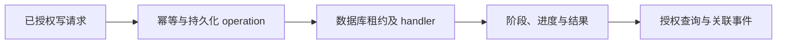

# Audit：可追踪的异步操作与审计

Audit 保存操作的发起者、授权范围、处理进度和结果，供外部集成、管理员和排障人员追踪。它包含持久化 ApiOperation、幂等请求、外部 API 请求审计和结构化运行事件；业务结果由业务资源与运行票据决定，运行恢复结合数据库事实与节点 inventory。

外部写请求通过身份、scope 和资源授权后，按 token、路由、幂等键与规范化请求摘要找回或创建 operation。同键同请求复用原任务，同键不同请求返回冲突。后台 worker 从数据库领取租约，通过按 kind 注册的 handler 执行任务、续租并更新阶段和进度；停止或失去租约时留下可恢复事实。调用方轮询 operation，再读取对应资源或运行状态。

operation 的公开数字状态为 Pending=0、Running=1、Succeeded=2、Failed=3；部署票据另有 Cancelled 等状态。stage 记录处理阶段，资源状态由对应模块维护。部署类 operation 关联原部署票据并沿用其状态机。附件上传则在事务内直接完成 operation，和后台排队任务分别处理。

列表按当前 token 隔离操作历史；单项查询需要当前 token 拥有该操作或具备显式 operation grant。管理员调用同样经过 token 资源授权。分页采用不透明 cursor，错误按稳定 code 处理。

审计只记录必要身份、资源、时间、关联标识和脱敏结果。token、Flag、密码、Cookie、私钥、Registry 凭据、完整 user-data 与资产文件内容不得写入审计或日志。当前 TeamLab 会话证据的内容限定为生命周期、关联身份和结束结果；命令审计与屏幕录制须按独立能力契约提供。

| 工作 | 入口 |
| --- | --- |
| operation 调用和恢复 | [异步操作契约](reference/operations.md) |
| 实现、存储和测试 | [开发地图](development.md) |
| 日志、指标和审计排障 | [观测与审计恢复](../../operations/observability-audit-recovery.md) |
| 对外通用要求 | [API 标准](../../architecture/external-api-standard.md) |

代码行为与现场证据分别维护；多进程故障和生产恢复的验收范围见 [当前状态](../../current-state.md) 和对应记录。
