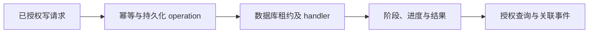

# Audit：可追踪的异步操作与审计

Audit 保存“谁在什么范围发起了什么操作、目前处理到哪一步、结果是什么”的可读事实，供外部集成、管理员和排障人员追踪。它包含持久化 ApiOperation、幂等请求、外部 API 请求审计和结构化运行事件；业务成功仍由业务资源与运行票据决定，日志文本不能作为恢复运行环境的唯一依据。

外部写请求通过身份、scope 和资源授权后，按 token、路由、幂等键与规范化请求摘要找回或创建 operation。同键同请求复用原任务，同键不同请求返回冲突。后台 worker 从数据库领取租约，通过按 kind 注册的 handler 执行任务、续租并更新阶段和进度；停止或失去租约时留下可恢复事实。调用方轮询 operation，再读取对应资源或运行状态。

operation 的公开数字状态只有 Pending=0、Running=1、Succeeded=2、Failed=3。Cancelled 属于其他状态模型，不是 ApiOperationStatus；stage 表达阶段，不替代业务状态。部署类 operation 关联原 DeploymentQueueTicket，不能复制一套部署状态机。附件上传还存在事务内直接完成的 operation，不能把所有 operation 都理解为排队执行。

列表只返回当前 token 发起的 operation，同一用户的其他 token 不自动共享历史；单项查询允许当前 token 或显式 operation grant，是否具备管理员角色本身不能跳过此授权。分页采用不透明 cursor，错误按稳定 code 处理。

审计只记录必要身份、资源、时间、关联标识和脱敏结果。token、Flag、密码、Cookie、私钥、Registry 凭据、完整 user-data 与资产文件内容不得写入审计或日志。TeamLab 会话证据属于生命周期记录，不能误称终端命令录像或屏幕录制。

| 工作 | 入口 |
| --- | --- |
| operation 调用和恢复 | [异步操作契约](reference/operations.md) |
| 实现、存储和测试 | [开发地图](development.md) |
| 日志、指标和审计排障 | [观测与审计恢复](../../operations/observability-audit-recovery.md) |
| 对外通用要求 | [API 标准](../../architecture/external-api-standard.md) |

以上是代码行为；多进程故障与生产恢复是否验收，须查 [当前状态](../../current-state.md) 和对应记录。
