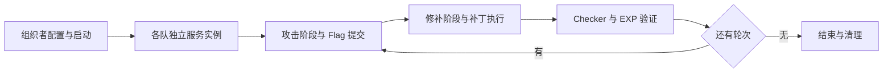

# AWDP 攻防

AWDP 是让队伍攻击其他队伍服务、再修补自己服务的攻防赛制，面向赛事组织者和已通过报名审核的选手。组织者先配置服务镜像、端口、检查脚本、攻击验证脚本、阶段时长和得分规则，再启动比赛。平台为各队创建独立服务实例，按轮次生成 Flag，并依次推进攻击阶段与修补阶段，最后保存榜单和操作记录。

攻击阶段中，选手获得其他队伍当前轮次的有效 Flag 后提交，平台核对服务、轮次、攻击方和被攻击方。重复答案、自身 Flag、过期轮次和超出次数的提交不能重复得分。修补阶段中，选手上传补丁包，平台在本队实例执行补丁，再运行 Checker（确认服务仍正常的脚本）和 EXP（验证原漏洞是否仍能利用的脚本）。只有 Checker 正常、EXP 无法再获得 Flag，才能说明漏洞被修补；把服务停掉并不算成功。

选手可以按服务配置的独立额度重置或恢复本队实例。当前两者都从原始镜像重建，并保留当前轮 Flag；区别是次数计数和审计记录，恢复不是只重启进程。重建也会使此前补丁失效，前端摘要应与最近的重建和验证事实一致。实例创建与重置经过统一运行队列，页面收到任务后仍需等待资源和入口就绪。

服务、轮次、攻击、补丁、重置和恢复由 AWDP 业务代码管理；节点资源、容器执行和访问入口由运行底座提供。开发定位见[开发页](development.md)。现有实现和自动化测试不等于目标环境已跑通真实攻防，完整流程由授权测试人员使用隐藏临时比赛按[手工验收指南](guides/manual-acceptance.md)执行，结果另记任务证据。生产与未决范围见[当前状态](../../current-state.md)。
