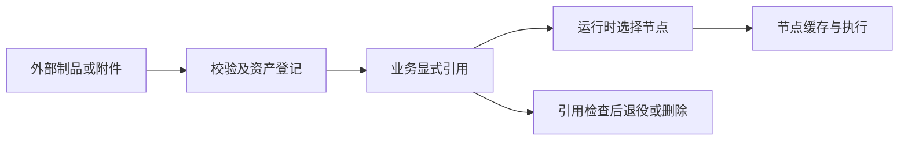

# Content：镜像、附件与内容资产

Content 管理业务可复用的内容资产，重点是镜像模板、导入任务、附件文件、启动配置和运行能力元数据。题目、课程、练习和 TeamLab 都可以引用资产，但比赛计分、课程学习进度和运行实例调度各自属于业务或 Runtime 模块。制作人员登记制品，教师引用到内容，管理员处理认证、删除和分发异常，外部流水线通过授权 API 上传或登记资产。

镜像先经过来源校验、导入和摘要确认，成为可查询的模板；业务绑定模板，TeamLab 发布保存模板 ID 与当时摘要。创建运行环境时先选择节点，再准备选中节点缺少的镜像。模板主状态回答“源资产是否就绪”，节点分发状态回答“某节点缓存是否就绪”，两者不能混成一个状态。显式预热是可选需求，不意味着所有创建都向全部节点复制。

附件上传按内容摘要复用文件；上传完成本身不增加题目附件引用。业务绑定与解绑负责引用生命周期，不能把有同一文件 Hash 的资产当成可随意删除。镜像删除也必须收集业务和运行引用，任一有效引用存在时拒绝；销毁课程或运行环境不能级联删除全局镜像主副本。

实现以 Content 的公开目录、引用检查和运行配置 query 为模块边界，导入 worker 与 Registry/VM 制品存储完成文件侧操作。节点缓存准备目前由 Fleet 分发服务执行，Agent 负责本机下载、校验和容量保护。远程访问配置保存于模板，但读取给其他模块的能力投影不包含密码或私钥。

本文描述已有代码职责，不证明自动 Blob GC、冷缓存策略或所有镜像冷启动已在目标环境验收。历史回收记录只证明当次操作，后续缺口与部署基线见 [当前状态](../../current-state.md)。

| 工作 | 入口 |
| --- | --- |
| 镜像导入、引用与缓存回收 | [镜像生命周期](reference/image-lifecycle.md) |
| 附件上传、绑定与访问 | [附件资产](reference/attachments.md) |
| 修改实现与选择验证 | [开发地图](development.md) |
| 对外身份、摘要和幂等 | [API 标准](../../architecture/external-api-standard.md) |
