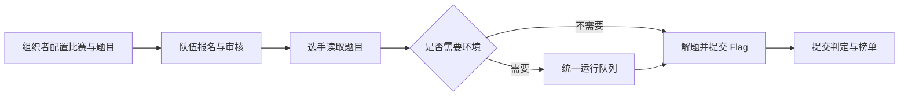

# CTF 竞赛

CTF（Capture The Flag，夺旗竞赛）面向参赛队伍和赛事组织者。组织者创建比赛、设置时间与赛制、维护题目和附件，再审核队伍报名；选手以获准参赛的队伍进入题目，下载附件或启动环境，找到 Flag（题目要求提交的答案）后提交。平台保存提交结果、解题记录和分数，形成榜单；报名成功、环境入队和答案通过是三个不同结果。

普通 CTF 的主要对象是比赛、参赛关系、比赛题目、队伍实例和提交。比赛题目保存赛事内的配置，镜像模板和附件等资产由内容模块管理。静态题按配置的答案判定，动态题使用所属实例的独立 Flag。Docker 容器与 VM 的创建交给统一运行底座：队列受理说明平台已接收任务，选手仍需等待实际执行和入口就绪。

渗透赛制的比赛绑定也在此阅读入口下说明，但实现归 Penetration 模块。组织者把 TeamLab 场景发布版本绑定到比赛，再配置目标、前置目标、尝试次数和重置策略；选手在本队工作区完成目标并得分。Penetration 拥有比赛绑定、目标、提交和玩法分数，TeamLab 拥有拓扑与运行环境，修改目标不能绕过 TeamLab 的发布和执行流程。AWDP、理论考试分别见[攻防模块](../awdp/README.md)和[理论模块](../theory/README.md)，不能套用普通 CTF 的判分逻辑。

目前业务入口同时分布在 `Controllers`、`Repositories`、`Services` 和 `Modules/Ctf`，并非所有赛事实现都已迁入模块目录。开发从[问题定位](development.md)进入；依赖和资产归属遵守[架构边界](../../architecture/module-boundary-map.md)。源码存在不代表每种 Docker、VM、渗透场景都已在目标环境验收，发布事实和未决范围以[当前状态](../../current-state.md)为准。
