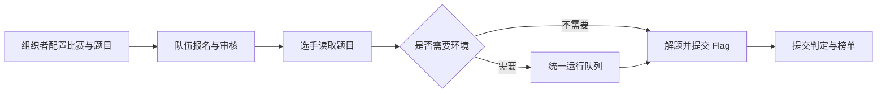

# CTF 竞赛

CTF（Capture The Flag，夺旗竞赛）面向参赛队伍和赛事组织者。组织者创建比赛、设置时间与赛制、维护题目和附件，再审核队伍报名。选手以获准参赛的队伍进入题目，下载附件或启动环境，找到 Flag（题目要求提交的答案）后提交。平台依次记录报名、环境任务和答案判定，保存解题记录与分数，形成赛事榜单。

普通 CTF 的主要对象是比赛、参赛关系、比赛题目、队伍实例和提交。比赛题目保存赛事内的配置，镜像模板和附件等资产由内容模块管理。静态题按配置的答案判定，动态题使用所属实例的独立 Flag。Docker 容器与 VM 的创建交给统一运行底座：队列受理说明平台已接收任务，选手仍需等待实际执行和入口就绪。

渗透赛制同样以比赛和队伍为入口，玩法由 Penetration 模块实现。组织者把 TeamLab 场景发布版本绑定到比赛，再配置目标、前置目标、尝试次数和重置策略；选手在本队工作区完成目标并得分。Penetration 管理比赛绑定、目标、提交和玩法分数，TeamLab 管理拓扑与运行环境，场景变更按 TeamLab 的发布和执行流程处理。[AWDP 攻防](../awdp/README.md)和[理论考试](../theory/README.md)各有独立的提交与判分规则。

当前比赛流程由主站接口、赛事仓库、判题服务和 CTF 应用代码共同处理。[开发页](development.md)按链路提供源码和测试位置，[架构边界](../../architecture/module-boundary-map.md)说明模块依赖与资产归属。Docker、VM 和渗透场景按具体目标环境验收，已发布结果和待验收范围见[当前状态](../../current-state.md)。
