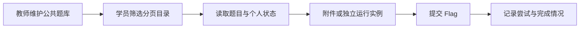

# 自主练习

自主练习面向希望在比赛之外持续解题的学员，也为教师提供公共题库维护入口。学员在练习目录按名称、分类、难度、标签、来源和完成状态筛选题目，进入详情后下载附件、启动所需环境并提交 Flag。平台保存个人尝试、已解 Flag 和题目完成状态，学员可查看自己的练习统计；公共练习不需要借用一场比赛或参赛关系。

教师可以新建、导入、编辑、启用或停用公共练习题，并维护附件、Flag 与镜像引用。题目来源可关联比赛、培训或攻防素材，但来源说明不意味着共用源比赛实例与 Flag。公共题定义、个人实例和练习提交是独立事实；动态题的答案应属于当前用户实例，不能直接使用管理员预览值。

课程也复用 Exercise 的题目与实例执行能力，但 `TrainingCourseId` 非空的课程题属于课程隔离快照。公共浏览、公共管理与外部 Exercise token API 都排除这些题，课程权限、额度和提交归培训模块。公共练习容器额度只统计公共练习；开启既有自动清理策略时，也不能清理课程实验。

练习浏览和管理目录采用服务端分页，默认每页20题，最多100题。后端先检查可见范围和筛选条件，再查询当前页；总数、启用题数和容器题数按全部匹配题计算。标签选项跨页稳定，不应从当页拼出全库统计。旧数组接口为兼容保留，个人统计页仍使用它们，不能用新分页的单页数据替代完整统计。接口参数和标签查询限制见[分页参考](reference/catalog-pagination.md)。

业务查询与写入已主要集中到 Exercise Application，Controller 负责前端协议入口，运行任务仍交统一底座。开发与定向测试见[开发页](development.md)。核心练习验收已有用户确认，10月11日分页 API 与页面亦有发布记录；这不证明所有题目镜像、内容运营和故障场景都验收完毕，当前范围见[状态页](../../current-state.md)。
