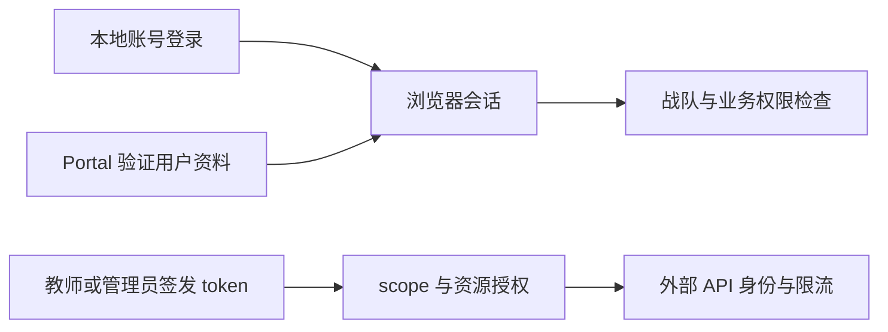

# 身份、战队与 API token

身份模块为学员、教师、管理员和外部集成提供账号与权限基础。用户通过本地登录建立浏览器会话，维护个人资料，并通过战队邀请或申请加入队伍；队长管理成员与入队请求。用户取得登录身份后，参加比赛还须报名并通过审核，学习课程须获得相应课程权限。战队成员关系用于确认用户所属队伍。

本地账号流程包含注册、验证、找回密码、密码重置、登录和退出，注册开放范围与验证码要求由账号配置决定。用户资料分为公开信息与本人私有统计，管理员修改角色、用户编辑个人资料分别通过对应入口处理。后端在请求时检查权限，页面按当前账号能力显示可用操作。

Portal SSO（通过统一门户登录）是另一条登录入口：主站使用传入的门户 token 请求配置的用户资料端点，验证账号与平台准入后，关联或创建本地账号并建立会话。本仓库维护门户对接代码，门户身份系统由外部系统提供。跨系统会话、角色映射和退出流程须在目标环境联调，已核验范围见[当前状态](../../current-state.md)。

API token 用于外部系统调用 `/api/open/v1`，与浏览器 Cookie 会话分开。教师及以上角色可按自己的权限签发 token，明文只在创建时返回一次，后端保存秘密摘要。scope 表示允许做什么操作，resource grant 表示可操作哪些具体资源。每次访问须同时满足签发的操作与资源授权，并受创建者当前角色限制。

用户、战队和本地会话通过主站接口与 ASP.NET Identity 管理，Identity 应用代码处理 token、当前操作者身份和授权契约。具体实现与测试见[开发页](development.md)，通用 token 契约见[外部 API 标准](../../architecture/external-api-standard.md)。维护记录使用脱敏信息，密码、Cookie、门户 token 和 API token 不得写入日志、截图报告或提交。
