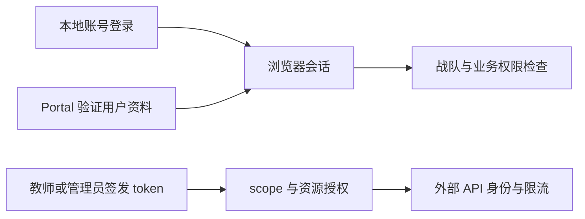

# 身份、战队与 API token

身份模块为学员、教师、管理员和外部集成提供账号与权限基础。用户可以通过本地登录建立浏览器会话，维护个人资料，并通过战队邀请或申请加入队伍；队长管理成员与入队请求。战队成员关系只说明用户属于哪个队伍，比赛还需要自己的报名和审核，课程也需要独立学习权限，不能用“已登录”代替业务授权。

本地账号流程包含注册、验证、找回密码、密码重置、登录和退出，具体能否注册、是否启用验证码由账号配置决定。用户资料读取会区分公开信息与本人私有统计，管理端的角色修改与普通用户资料编辑也属于不同入口。排查页面按钮时，应检查后端权限条件，不能把隐藏按钮当成授权措施。

Portal SSO（通过统一门户登录）是另一条登录入口：主站使用传入的门户 token 请求配置的用户资料端点，验证账号与平台准入后，关联或创建本地账号并建立会话。本仓库只有对接代码，没有门户身份系统本身。解析测试通过不能证明跨系统会话、角色映射和退出流程已在目标环境验收；验收范围见[当前状态](../../current-state.md)。

API token 用于外部系统调用 `/api/open/v1`，与浏览器 Cookie 会话分开。教师及以上角色可按自己的权限签发 token，明文只在创建时返回一次；后端保存秘密摘要。scope 表示允许做什么操作，resource grant 表示可操作哪些具体资源，两者和创建者当前角色都必须满足。token 有效不代表管理员，也不会自动获得未签发的资源权限。

用户、战队和本地会话仍主要由传统 Controller、ASP.NET Identity 与 Repository 实现；`Modules/Identity` 集中处理 token、actor（当前操作者身份）和授权契约。具体实现与测试见[开发定位](development.md)，通用 token 契约见[外部 API 标准](../../architecture/external-api-standard.md)。密码、Cookie、门户 token 和 API token 不得写入日志、截图报告或提交。
