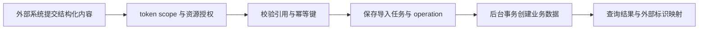

# 教学与战队批量导入

Provisioning 在本仓库指教学内容与战队的批量导入，面向需要通过接口建课程、题库、试卷或战队的教师和管理员。它接收结构化数据，校验外部系统给出的关联标识，再创建平台业务对象。导入模块准备教学和组织数据，运行环境由 Runtime、VM 和 Agent 负责。

当前有四类导入：培训课程及其章节、实验和课后试卷；理论题库；Theory/Mixed 比赛的试卷；战队及其既有用户成员。单次请求的上限分别为50个课程、1000道理论题或试卷题、200个战队。导入战队时，队长与成员按平台已有用户绑定，账号须事先存在。

接口只接受 API token。教师可按权限导入课程、理论题库和获授权比赛的试卷，管理员才能批量建战队。scope 说明允许的操作，resource grant 说明资源范围，二者都要校验。每次写入还需要 `Idempotency-Key`：同一 token 在同一路由重试相同内容返回原操作，同键换内容返回冲突，避免网络重试生成重复课程或队伍。

服务先保存任务与 operation（可查询的持久化异步操作），返回202表示已受理。外部调用方查询操作状态，成功后取得导入结果。后台在数据库事务中创建对象，返回外部标识与平台 ID 的映射。课程题作为课程拥有的独立快照保存，课程通过引用使用现有镜像模板，模板主副本仍归内容模块。比赛试卷替换适用于尚无最终答卷的试卷，已有答卷继续对应原试卷内容。

开发者从[开发页](development.md)查接口、数据字段、校验、任务执行和测试，公共协议见[外部 API 标准](../../architecture/external-api-standard.md)。外部系统按实际数据和目标环境联调，重点核对引用、权限、重试与最终结果，已发布能力和验收范围见[当前状态](../../current-state.md)。
