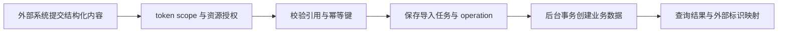

# 教学与战队批量导入

Provisioning 在本仓库指教学内容与战队的批量导入，面向需要通过接口建课程、题库、试卷或战队的教师和管理员。它接收结构化数据，校验外部系统给出的关联标识，再创建平台业务对象；这里的“准备资源”指业务数据，不是 VM 创建、节点配置或镜像分发。运行环境由 Runtime、VM 和 Agent 负责。

当前有四类导入：培训课程及其章节、实验和课后试卷；理论题库；Theory/Mixed 比赛的试卷；战队及其既有用户成员。课程导入一次最多50个课程，理论题库和单份试卷最多1000题，战队一次最多200个。这些数字是单次请求的校验上限，不是平台总容量。战队导入不会创建用户账号，队长与成员必须能匹配现有用户。

接口只接受 API token。教师可按权限导入课程、理论题库和获授权比赛的试卷，管理员才能批量建战队。scope 说明允许的操作，resource grant 说明资源范围，二者都要校验。每次写入还需要 `Idempotency-Key`：同一 token 在同一路由重试相同内容返回原操作，同键换内容返回冲突，避免网络重试生成重复课程或队伍。

服务先保存任务与 operation（可查询的持久化异步操作），返回202表示已受理，外部调用方需要查询操作结果后才能认定导入完成。后台在数据库事务中创建对象，并返回外部标识与平台 ID 的映射；课程题是课程拥有的独立快照，课程引用现有镜像模板，不取得模板主副本所有权。存在最终答卷的比赛试卷不能被导入覆盖，防止已有成绩对应到另一套题目。

开发者从[定位页](development.md)查 API、校验、任务执行和测试。模型字段以当前 [AcademicImportContracts](../../../src/GZCTF/Modules/Provisioning/Contracts/AcademicImportContracts.cs) 为准，公共协议见[外部 API 标准](../../architecture/external-api-standard.md)，不会在此维护第二份 DTO 表。源码具备导入能力不代表所有外部系统已完成联调，实际发布与验收范围见[当前状态](../../current-state.md)。
