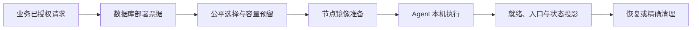

# Runtime：统一运行底座与节点执行

Runtime 把业务的创建、重置、销毁等请求转换成可排队、可恢复的运行工作。CTF、练习、课程、AWDP 和 TeamLab 共用 DeploymentQueueTicket；业务模块决定用户是否有权使用环境，Runtime 决定工作何时、在哪个节点执行。运维人员用它观察队列、容量、节点与恢复结果，开发者通过统一入口接入新运行用例。

请求先完成业务校验，再写入数据库票据。调度按照工作对象串行约束、创建者公平性、节点能力与资源余量筛选；容量预留成功后准备选中节点的镜像，再调用 Agent 创建网络、容器或虚拟机。访问入口完成自身就绪检查或网关 ACK 后，再向用户展示可用地址。停止、重建与销毁沿用同一队列、运行身份和代次。

源码分布在 Modules/Runtime、Services/Fleet、Services/Vm 和独立 GZCTF.Agent。Runtime worker 管理调度、执行、信号和对账；Fleet 负责节点通讯、镜像准备、端口租约及现有 VM/容器适配；Agent 使用 Docker、KVM/libvirt 与本机网络工具执行已验证意图。VM 的当前实现入口位于 Services/Fleet、Services/Vm 和 Agent，开发地图按这些实际目录定位。

PostgreSQL 是票据和运行状态事实源，Redis 提供唤醒、租约和高频状态缓冲；恢复必须对比数据库当前代与 Agent inventory。Docker 和 KVM 独立判定，具备 Docker 能力的节点可以单独承载容器。VM 按镜像和访问协议检查来宾初始化、管理网络、RDP/SSH 服务或图形控制台，Windows 与 Linux 各有适用条件。

代码支持与真实链路验收分别记录。节点故障、多 worker 恢复、磁盘硬配额与完整冷启动的验收范围，按 [当前状态](../../current-state.md) 和真实记录确认；生产操作遵守明确授权及发布流程。

| 任务 | 入口 |
| --- | --- |
| 修改或排查运行链路 | [开发地图](development.md) |
| 理解票据、容量和恢复 | [调度与恢复](reference/scheduling-recovery.md) |
| VM、Docker 与节点边界 | [Agent 与 VM 执行](reference/agent-vm.md) |
| 现场运行恢复 | [运维手册](../../operations/runtime-scheduling-and-recovery.md) |
