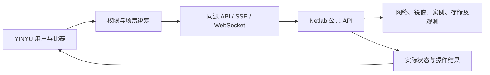

# TeamLab：组网场景

TeamLab 将独立 Netlab 工作区接入 YINYU。教师在场景页制作和发布模板，在比赛中选择版本、设置目标并为队伍部署环境；选手从比赛进入本队画布、控制台、文件与流量视图，提交目标和重建申请由比赛规则处理。

YINYU 管理用户、参赛关系、开放时间、目标、Flag、计分和重建次数。Netlab 管理环境规格、镜像、调度、运行、访问与清理。上层保存场景版本和环境标识，通过公共 API 读取运行状态；画布和运维组件从底座正式前端迁入上层，随上层源码一起构建。

管理员配置一次底座地址、已授权项目和普通服务 Token。教师管理自己创建的场景及负责比赛的环境；选手权限限定到当前比赛的本队环境。Token 保存在上层服务端，浏览器沿用 YINYU 登录状态。

| 工作 | 入口 |
| --- | --- |
| 连接底座、制作场景与用于比赛 | [接入与使用](netlab-integration.md) |
| 定位源码、生成契约与验证 | [开发地图](development.md) |
| 核对代码与上线范围 | [任务记录](../../records/2026-11-10-netlab-integration.md)、[当前状态](../../current-state.md) |

原 release-v2 四机场景和镜像已迁入独立 YINYU 项目，真实启停通过；流量解析及 VM 初始化文件的剩余工作见 [后续事项](../../backlog.md)。旧执行面的文档保存在 [历史参考](../../archive/teamlab-internal-20261110/reference/README.md)，用于核对原数据和现场配置。
