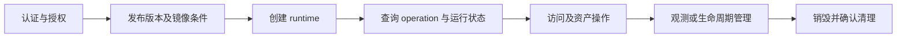

# TeamLab 组网底座对接

外部系统只使用 `/api/open/v1/teamlab`；管理端浏览器接口和 Agent 接口使用不同身份，不承诺同一兼容性。先取得 API scope 与控制范围授权，再按以下链路调用。

| 调用阶段 | 专题 |
| --- | --- |
| 认证、请求头、幂等和 operation | [调用约定](integration-authentication.md) |
| 预热或按需准备、创建、状态和资产 | [创建与查询](integration-runtime.md) |
| Runtime Grant 与运行中资产变更 | [授权与变更](integration-grants-updates.md) |
| 启停重建和资产服务端口 | [单资产及服务控制](integration-asset-control.md) |
| SSH/RDP/VNC/终端与文件 | [会话和文件](integration-sessions-files.md) |
| 暂停恢复、观测、WireGuard、rollout | [生命周期与观测](integration-lifecycle-observation.md) |
| 请求失败、冲突和恢复 | [错误处理](integration-errors.md) |

202 只表示受理；operation 成功、运行态与实际网络/登录可用性分别判断。单资产控制返回原部署票据；不要套用 operation 的数字枚举。重复未知结果请求保留原幂等键。

字段级索引见 [API 参考](../reference/README.md)，稳定边界见 [外部控制面契约](../reference/external-control-plane.md)，镜像和场景制作见 [交付指南](authoring.md)。实现与部署证据分开，限定验收见 [当前状态](../../../current-state.md)。
