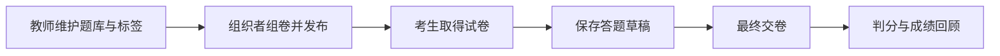

# 理论考试

理论模块面向出题教师、赛事组织者和考生，管理选择题与判断题，从题库检索、组卷、发布到保存草稿、最终交卷和成绩回顾。教师在题库中维护可复用的问题，组卷时保存本次考试的问题、选项、正确答案、分值和顺序。已发布试卷使用这份题目快照，考生答卷保存个人选择与判分结果。

组织者在 Theory 或 Mixed 类型比赛中准备试卷，检查题目和分值后发布。考生须在允许答题的比赛时间内，并有已通过审核的参赛关系，才能读取已发布试卷和保存草稿。最终交卷时，服务校验题目归属与选项范围，再对全部选择判分。多选题的选择与正确答案集合完全一致时得本题全分，其余情况得零分；最终提交后答题内容固定。

比赛榜单按获准参赛队伍汇总该队已提交答卷的最佳成绩，同分再按提交时间排序。草稿供考生继续作答，正式得分取自最终提交的答卷。管理端可以查看提交与重算成绩；已有最终答卷的试卷保留原题目内容，替换仅适用于尚无最终答卷的试卷。题库名称表达归属，标签用于按内容检索。

课程课后测试复用理论题规范和答题工作台，课程试卷、重考次数与学习进度由[培训模块](../training/README.md)独立保存。外部系统使用 API token，经[批量导入模块](../provisioning/README.md)导入题库或替换符合条件的比赛试卷。

题库查询、试卷管理、答题与统计由主站接口、理论服务和模块应用代码共同处理，具体入口、判分方法和现有测试见[开发页](development.md)。正确答案与回顾信息按答卷状态和权限返回，考生读取范围由后端控制。生产事实和待验收范围见[当前状态](../../current-state.md)。
