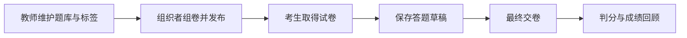

# 理论考试

理论模块面向出题教师、赛事组织者和考生，管理选择题与判断题，从题库检索、组卷、发布到保存草稿、最终交卷和成绩回顾。题库用于维护可复用的问题；试卷保存本次考试的问题、选项、正确答案、分值和顺序，考生答卷保存个人选择与判分结果。题库、试卷和答卷承担不同职责，修改题库不应被解释成修改已发布试卷。

组织者在 Theory 或 Mixed 类型比赛中准备试卷，检查题目和分值后发布。考生必须处于允许答题的比赛时间内，并有已通过审核的参赛关系，才能读取已发布试卷和保存草稿。最终交卷时，服务校验题目归属与选项范围，再对全部选择进行判分；多选题要求所选答案与正确答案集合完全一致，不按选中部分给分。最终提交后不能继续覆盖原答卷。

比赛榜单按获准参赛队伍汇总该队已提交答卷的最佳成绩，同分再按提交时间排序。草稿不会变成正式得分。管理端可以查看提交与重算成绩；存在已提交答卷时，试卷不能被直接替换，避免旧答案对应到新题。题库名称表达题库归属，标签表达检索维度，二者不能互相代替。

课程课后测试复用理论题规范和答题工作台，但课程试卷、重考次数与学习进度归[培训模块](../training/README.md)；它们不作为比赛答卷写入。外部系统可通过[批量导入模块](../provisioning/README.md)导入题库或替换符合条件的比赛试卷，不能凭浏览器登录访问 token API。

实现仍包含传统 Controller 和 `TheoryExamService`，模块目录主要承载题库契约、标签和统计投影。具体入口、判分方法和现有测试见[开发定位](development.md)。答题及回顾的实际可见范围以响应模型和当前权限为准，不能仅凭管理端拥有答案就让考生提前看到正确答案。生产事实见[当前状态](../../current-state.md)。
