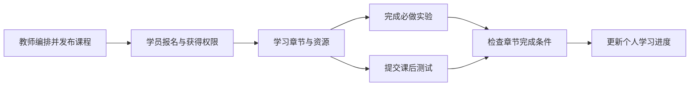

# 培训课程

培训模块面向授课教师、课程负责人和学员，把课程资料、章节、实验、课后测试与学习进度组织在同一条学习流程中。教师创建课程和章节，配置视频、资源、实验及理论试卷，发布内容并管理报名；学员获得课程学习权限后，进入已发布章节，阅读资料、完成必做实验和课后测试。平台保存个人进度，教师可以查看报名与学员学习详情。

“完成章节”不只是点击按钮。平台先记录阅读进度，再判断章节要求的实验和课后测试是否完成；条件未满足时返回真实阻塞原因，不把阅读结束当成课程完成。理论测试支持草稿和最终提交，只有试卷允许重考且上一份答卷已提交时才能新建一次尝试。课程成绩和进度独立保存，不混入比赛榜单。

课程实验绑定课程拥有的练习题快照，即导入时复制的题目定义。它复用 Exercise 的实例执行代码，但课程题不会出现在公共练习目录，课程提交也使用自己的记录。同一用户在同一实验重复启动会复用有效实例或创建票据；不同实验的容器、端口和动态 Flag 分别隔离。运行任务使用统一 `DeploymentQueueTicket`，不能仅靠按钮返回成功判断实验可访问。

课程容器默认每用户上限为3，按用户跨课程统计，已运行实例和活跃创建票据共同占额度。管理员可动态修改上限，0只表示不限制个人数量，仍受节点容量与全局准入限制；降低额度不会自动停止已有实验。具体计数、锁、动态 Flag 修复和发布证据见[容器生命周期参考](reference/container-lifecycle.md)，这里不重复参数细节。

课程权属、内容和进度仍主要位于传统培训 Controller，删除用例已单独抽到 Training Application。开发从[定位页](development.md)查起；镜像主资产由[内容模块](../content/README.md)管理，课程只有引用。10月11日已有课程三容器、动态设置和分页限定验收记录，其他环境和故障场景的当前事实仍见[状态页](../../current-state.md)。
