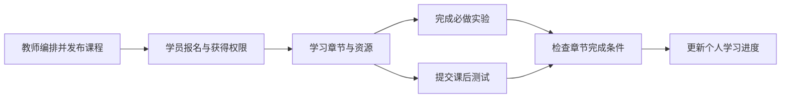

# 培训课程

培训模块面向授课教师、课程负责人和学员，把课程资料、章节、实验、课后测试与学习进度组织在同一条学习流程中。教师创建课程和章节，配置视频、资源、实验及理论试卷，发布内容并管理报名；学员获得课程学习权限后，进入已发布章节，阅读资料、完成必做实验和课后测试。平台保存个人进度，教师可以查看报名与学员学习详情。

学员标记阅读完成后，平台检查章节要求的实验和课后测试，并更新章节与课程进度。必做实验或测试尚未完成时，页面显示仍需完成的内容。理论测试支持草稿和最终提交；试卷允许重考且上一份答卷已提交时，学员可新建一次尝试。课程独立保存成绩与进度。

课程实验绑定课程拥有的练习题快照，即导入时复制的题目定义。课程题在课程内访问，提交单独记录，实例执行复用 Exercise 的能力。同一用户在同一实验重复启动会复用有效实例或创建票据；不同实验的容器、端口和动态 Flag 分别隔离。运行任务进入统一队列，资源和入口就绪后，学员即可访问实验。

课程容器默认每用户上限为3，按用户跨课程统计，已运行实例和活跃创建票据共同占额度。管理员可动态修改上限，0表示个人数量不限，节点容量与全局准入条件仍适用。降低额度后，已有实验继续运行，后续新建按新上限判断。具体计数、动态 Flag 修复和发布证据见[容器生命周期参考](reference/container-lifecycle.md)。

培训入口处理课程权属、内容和进度，课程删除由应用服务检查权限并组织清理。[开发页](development.md)提供这些链路的源码和测试位置。镜像主资产由[内容模块](../content/README.md)管理，课程通过引用使用模板。10月11日已记录课程三容器、动态设置和分页限定验收，其他环境和故障场景的范围见[当前状态](../../current-state.md)。
