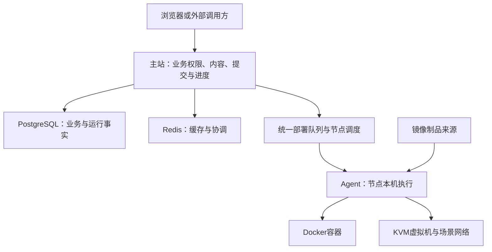

# 了解 YINYU

YINYU 是面向教师、赛事组织者、学员和平台运维人员的安全演练平台。它把比赛、练习、理论考试、课程和多机组网场景放在同一站点，共用用户、内容和运行资源。先从下表选择要了解的功能，不需要先读部署日志或全部接口。

| 功能 | 使用者要完成什么 | 大体实现 |
| --- | --- | --- |
| [CTF与渗透玩法](modules/ctf/README.md) | 组织比赛、参赛、提交并计分 | 赛事保存参赛与得分事实，题目需要环境时调用运行底座；渗透玩法关联TeamLab |
| [AWDP](modules/awdp/README.md) | 按轮次检查服务、攻击和修补 | 维护服务/轮次/Checker与计分，真实攻防另做专项验收 |
| [理论考试](modules/theory/README.md) | 维护题库、组卷、答题和看成绩 | 保存答卷快照与提交，再依据题型判分 |
| [培训](modules/training/README.md) | 按课程与章节学习、做实验 | 课程管理教师/报名/进度，课程实验使用独立题目实例 |
| [自主练习](modules/exercise/README.md) | 随时筛选题目、开实例与提交 | 保存公共练习和每位用户的实例，与课程和比赛分开 |
| [TeamLab组网](modules/teamlab/README.md) | 把多台资产组成可重复运行的场景 | 草稿发布为不可变版本，再创建隔离运行环境，由节点执行网络与资产操作 |
| [身份与权限](modules/identity/README.md) | 登录、管理账号和对接授权 | 本地/SSO身份、角色、Token及资源授权共同限定可执行操作 |

平台还包含 [内容与镜像](modules/content/README.md)、[运行与节点](modules/runtime/README.md)、[审计与异步操作](modules/audit/README.md) 和 [批量导入](modules/provisioning/README.md)。这些能力供多个功能复用，不需要每个业务自己管理一套容器或文件系统。

图展示主要工作关系，不是每个模块的完整依赖矩阵。主站决定业务许可与资源归属，Agent执行经过校验的本机操作；队列中受理成功与环境真正可用是不同阶段。代码在main、软件测试通过、生产已部署、真实业务已验收也分别记录，不能用一项替代另一项。

要看当前进度与重点问题，读 [当前状态](current-state.md)。要动手开发，读对应模块的 `development.md`；需要部署或排障，进入 [运维手册](operations/README.md)。项目的技术栈、本地运行命令仍在 [仓库README](../README.md)。
